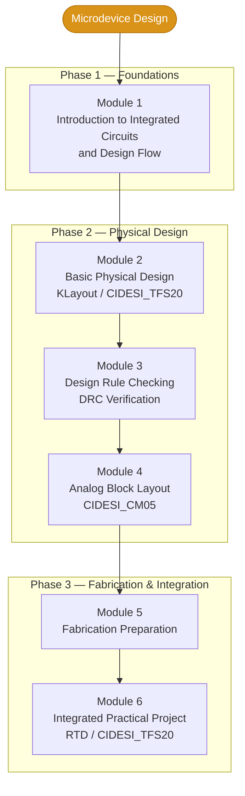

# CIDESI_BChips_2026

**Bajío – Semiconductor Industry Enabler Training Program**

Center for Engineering and Industrial Development (CIDESI)

## Semiconductor Training Roadmap

*The diagram represents the learning roadmap.
Some training periods overlap.*

## Microdevice Design — Learning Modules

## Module Documentation

### Module 1 — Introduction to Integrated Circuits
Fundamentals of integrated circuits and the semiconductor design flow.

### Module 2 — Basic Physical Design
Introduction to KLayout and the CIDESI_TFS20 technology.

### Module 3 — Design Rule Checking (DRC)
Physical layout verification and design-rule compliance.

### Module 4 — Analog Block Layout
Analog layout development using CIDESI_CM05.

### Module 5 — Fabrication Preparation
Design preparation for semiconductor fabrication.

### Module 6 — Integrated Practical Project
RTD design and integration using CIDESI_TFS20.

## Tools and Technologies

- KLayout
- LTspice
- SPICE Simulation
- DRC Verification
- GDSII
- CIDESI_TFS20
- CIDESI_CM05

## Project Status

Training and technical documentation in progress.
