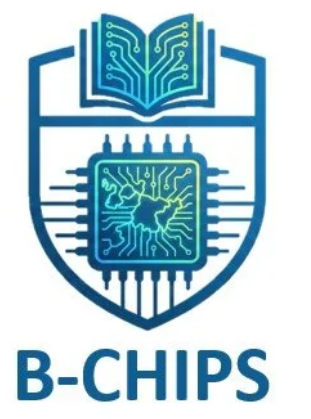
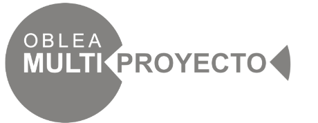
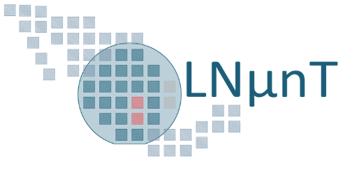
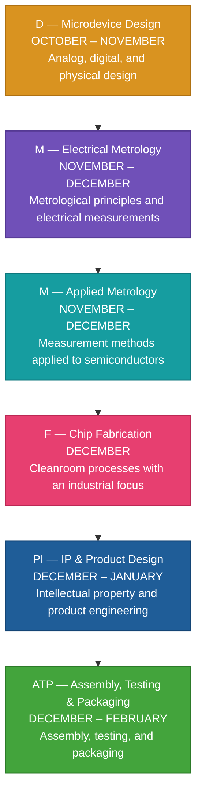
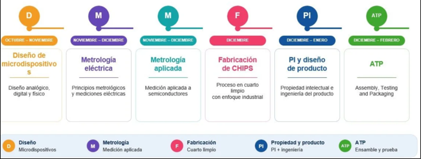
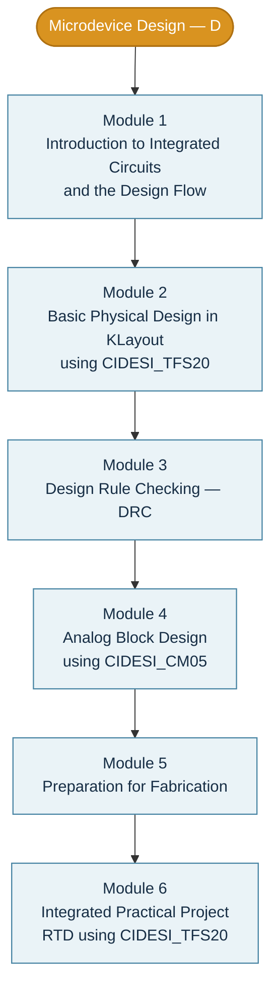

<p align="center">
  
</p>

<h1 align="center">CIDESI · B-CHIPS 2026</h1>

<p align="center">
  <strong>Bajío — Semiconductor Industry Enabler Training Program</strong><br>
  Center for Engineering and Industrial Development (CIDESI)
</p>

<p align="center">
  <a href="#program-roadmap">Program Roadmap</a> ·
  <a href="#microdevice-design-modules">Design Modules</a> ·
  <a href="#tools-and-technologies">Tools & Technologies</a> ·
  <a href="#repository-organization">Repository Organization</a>
</p>

---

## Program and Institutional Identities

<!-- Sized using standard HTML attributes supported in GitHub Markdown. -->
<table align="center">
  <tr>
    <td align="center" width="33%">
      <br>
      <sub>Oblea Multiproyecto</sub>
    </td>
    <td align="center" width="33%">
      <br>
      <sub>Laboratorio Nacional de Micro y Nano Tecnologías (LNµnT)</sub>
    </td>
    <td align="center" width="33%">
      <br>
      <sub>Center for Engineering and Industrial Development (CIDESI)</sub>
    </td>
  </tr>
</table>

## About This Repository

This repository documents the **B-CHIPS semiconductor training program**, including the learning roadmap, design exercises, tool workflows, physical verification, and technical notes developed throughout the program.

The content is organized around microdevice design, metrology, semiconductor fabrication, product engineering, and assembly, testing, and packaging (ATP).

> **Scope:** A personal technical learning repository. Logos and program descriptions are reproduced from the supplied course materials; this repository is not presented as an official institutional publication.

---

## Program Roadmap

The following diagram includes the **six training areas, the time windows, and the full descriptions shown in the original program roadmap**. Arrows indicate how the areas are organized in this repository; they do not imply strict prerequisites or non-overlapping schedules.



### Training Areas and Descriptions

| Area | Training period | Description |
|:--|:--|:--|
| **D — Microdevice Design** | October–November | Analog, digital, and physical design. |
| **M — Electrical Metrology** | November–December | Metrological principles and electrical measurements. |
| **M — Applied Metrology** | November–December | Measurement methods applied to semiconductors. |
| **F — Chip Fabrication** | December | Cleanroom processes with an industrial focus. |
| **PI — Intellectual Property & Product Design** | December–January | Intellectual property and product engineering. |
| **ATP — Assembly, Testing & Packaging** | December–February | Assembly, Testing, and Packaging. |

<details>
<summary><strong>View the original Spanish program roadmap</strong></summary>

<p align="center">
  
</p>

</details>

---

## Microdevice Design Modules

The microdevice-design area is organized into **six modules**, following the course outline.



| Module | Course topic | Focus |
|:--|:--|:--|
| **01** | Introduction to integrated circuits and the design flow | Foundational concepts and workflow. |
| **02** | Basic physical design in KLayout with CIDESI_TFS20 | Layout design using the specified technology. |
| **03** | Design Rule Checking (DRC) | Verification against physical design rules. |
| **04** | Analog block design with CIDESI_CM05 | Physical design of analog blocks. |
| **05** | Preparation for fabrication | Preparing a design for manufacturing. |
| **06** | Integrated practical project (RTD using CIDESI_TFS20) | Integration of the concepts in a practical project. |

---

## Tools and Technologies

- **KLayout:** Physical layout editing and inspection.
- **LTspice / SPICE:** Circuit analysis and simulation.
- **DRC:** Design Rule Checking.
- **GDSII:** Layout data exchange format.
- **CIDESI_TFS20 and CIDESI_CM05:** Technologies referenced in the training modules.

## Repository Organization

Suggested organization as coursework and documentation are added:

```text
CIDESI_BChips_2026/
├── README.md
├── LICENSE
├── assets/
│   └── images/
│       ├── bchips-logo.png
│       ├── oblea-multiproyecto-logo.png
│       ├── lnunt-logo.png
│       ├── cidesi-logo.png
│       └── original-program-roadmap.png
├── 01_Microdevice_Design/          # Planned
│   ├── Module_01_IC_Design_Flow/
│   ├── Module_02_KLayout_TFS20/
│   ├── Module_03_DRC/
│   ├── Module_04_Analog_CM05/
│   ├── Module_05_Fabrication_Preparation/
│   └── Module_06_RTD_Project/
├── 02_Electrical_Metrology/        # Planned
├── 03_Applied_Metrology/           # Planned
├── 04_Chip_Fabrication/            # Planned
├── 05_IP_Product_Design/          # Planned
└── 06_Assembly_Testing_Packaging/ # Planned
```

> The module folders above are a proposed structure, not files already included in this package. Create them as the course progresses.

---

## Documentation Status

Technical documentation and training exercises are in progress.

*Program dates and descriptions are based on the supplied roadmap; no year is assigned to the individual schedule windows in that source.*
